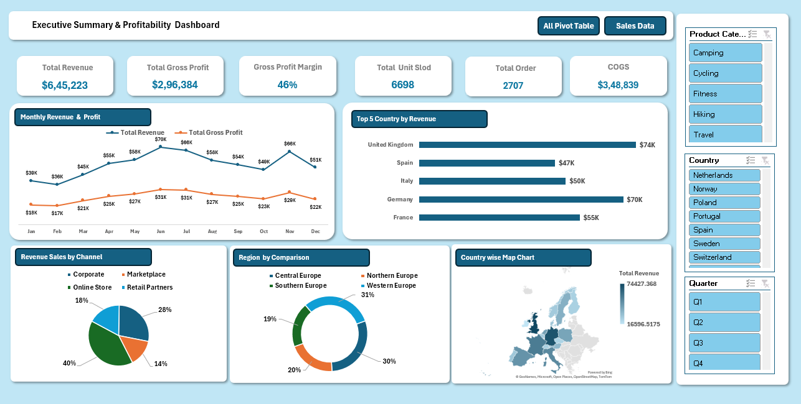

# Excel Sales Dashboard | Sales Data Analysis

## Project Overview
Developed an interactive **Sales Dashboard using Microsoft Excel** to analyze sales performance, revenue, gross profit, and business trends. The dashboard uses PivotTables, PivotCharts, and interactive filters to help users explore sales data across different regions, countries, sales channels, and customer segments.

## Key Features
- **KPI Analysis:** Total Revenue, Gross Profit, Gross Profit Margin, and Units Sold.
- **Sales Channel Analysis:** Compare Corporate, Marketplace, Online Store, and Retail Partners.
- **Regional Analysis:** Explore sales performance across regions and countries.
- **Customer Segmentation:** Analyze new, returning, and business customers.
- **Interactive Dashboard:** Use PivotCharts, slicers, and filters to explore data dynamically.
- **Time-Based Analysis:** Analyze sales trends by month, quarter, and year.

## Tools & Skills
- Microsoft Excel
- PivotTables & PivotCharts
- Data Cleaning and Transformation
- Data Analysis
- Dashboard Design
- KPI Reporting
- Data Visualization

## Objective
To transform raw sales data into meaningful business insights, identify sales trends, and support data-driven decision-making through an interactive Excel dashboard.
## Dashboard Preview

